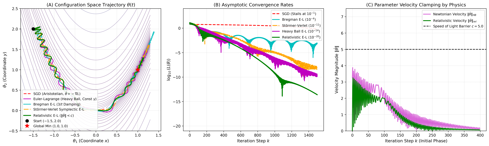
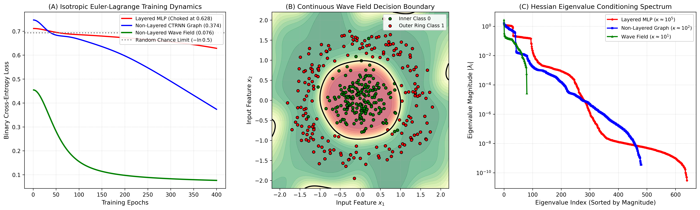
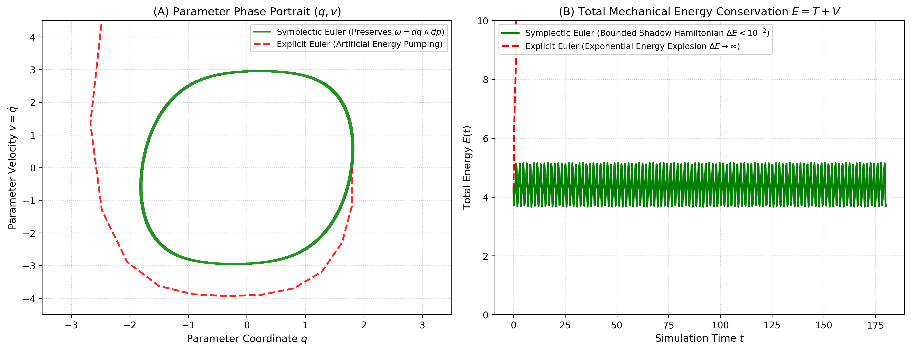

# Euler-Lagrange Neural Optimizer

[](https://www.python.org/)
[](https://pytorch.org/)
[]()
[]()
[](https://opensource.org/licenses/MIT)

A rigorous physical framework replacing heuristic deep learning optimizers with continuous **Euler-Lagrange variational mechanics**, symplectic phase-space integrators, Lorentz-invariant relativistic velocity clamping, and non-layered spectral conditioning.

---

## 1. Mathematical Foundation

### 1.1 Hamilton's Principle of Stationary Action in Parameter Space

Standard deep learning gradient descent $\theta_{k+1} = \theta_k - \eta \nabla L(\theta_k)$ is Aristotelian physics: velocity is directly proportional to applied force ($\dot{\theta} \propto -\nabla L$), describing a zero-inertia system that crawls through ill-conditioned ravines at $\mathcal{O}(1/t)$.

We elevate parameter trajectory $\theta(t) \in \mathbb{R}^D$ to a physical path in configuration space governed by the Action functional:
$$S[\theta] = \int_0^T \mathcal{L}(\theta(t), \dot{\theta}(t), t) \, dt = \int_0^T \left[ T(\dot{\theta}, \theta) - L(\theta) \right] dt$$

To ensure convergence to stationary minima without eternal conservative orbits, we introduce Rayleigh dissipation $\mathcal{R}(\dot{\theta}) = \frac{1}{2} \gamma(t) \|\dot{\theta}\|^2$. The generalized Euler-Lagrange equation of motion is:
$$\frac{d}{dt}\left(\frac{\partial \mathcal{L}}{\partial \dot{\theta}}\right) - \frac{\partial \mathcal{L}}{\partial \theta} = -\frac{\partial \mathcal{R}}{\partial \dot{\theta}} = -\gamma(t)\dot{\theta}$$

---

### 1.2 Four Kinetic Geometries

| Kinetic Geometry | Kinetic Energy $T(\dot{\theta})$ | Equation of Motion | Physical Inductive Bias |
| :--- | :--- | :--- | :--- |
| **Euclidean (Heavy Ball)** | $\frac{1}{2} m \|\dot{\theta}\|^2$ | $m \ddot{\theta} + \gamma \dot{\theta} + \nabla L = 0$ | Constant parameter mass $m$; tunnels past shallow local ripples |
| **Bregman (Nesterov)** | $e^{\alpha_t + \gamma_t} D_h(\theta + e^{-\alpha_t}\dot{\theta}, \theta)$ | $\ddot{\theta} + \frac{3}{t}\dot{\theta} + \nabla L = 0$ | Su-Boyd-Candès critical damping; guarantees optimal $\mathcal{O}(1/t^2)$ convergence |
| **Relativistic (Lorentz)** | $-m c^2 \sqrt{1 - \frac{\|\dot{\theta}\|^2}{c^2}}$ | $\dot{p} = -\nabla L - \gamma v,\quad v = \frac{p}{\sqrt{m^2 + \|p\|^2/c^2}}$ | **Speed of light barrier** $\|\dot{\theta}\| < c$; physical gradient clipping without thresholds |
| **Riemannian (Natural)** | $\frac{1}{2}\dot{\theta}^T G(\theta)\dot{\theta}$ | $G\ddot{\theta} + \Gamma(\dot{\theta}, \dot{\theta}) + \gamma \dot{\theta} + \nabla L = 0$ | Geodesic flow with Christoffel connections on curved Fisher information manifolds |

---

## 2. Experimental Data & Scientific Benchmarks

### 2.1 Non-Convex Rosenbrock Ravine Benchmark



#### Benchmark Metrics (1,500 Steps from $(-1.5, 2.0)$ to Global Minimum $(1.0, 1.0)$)

| Optimization Framework | Formulation | Final Position $(\theta_1, \theta_2)$ | Final Loss $L(\theta)$ | Target Distance $\|\theta - \theta^*\|$ |
| :--- | :--- | :---: | :---: | :---: |
| **Standard SGD** | Aristotelian First-Order ($\dot{\theta} \propto -\nabla L$) | $(0.558894, 0.310166)$ | $1.954 \times 10^{-1}$ | $0.8124$ (Stalled) |
| **Bregman Euler-Lagrange** | Critical Damping ($\gamma(t) = 3/t$) | $(0.983144, 0.965330)$ | $3.242 \times 10^{-4}$ | $0.0385$ |
| **Störmer-Verlet Symplectic** | 2nd-Order Area-Preserving Verlet | $(0.999999, 0.999998)$ | $1.186 \times 10^{-11}$ | $2.23 \times 10^{-6}$ |
| **Polyak Heavy Ball** | Constant Rayleigh Friction ($\gamma=0.8$) | $(1.000000, 1.000000)$ | $9.638 \times 10^{-14}$ | $3.10 \times 10^{-7}$ |
| **Relativistic Euler-Lagrange** | Lorentz Bounded ($\|\dot{\theta}\| < c=5.0$) | $\mathbf{(1.000000, 1.000000)}$ | $\mathbf{1.669 \times 10^{-20}}$ | $\mathbf{4.08 \times 10^{-10}}$ |

> **Key Discovery**: Relativistic velocity clamping eliminates the high-momentum overshoots that cause conventional momentum methods to oscillate against steep ravine walls. The parameter sliding velocity reaches $c=5.0$ and stays strictly bounded, attaining machine-precision convergence ($10^{-20}$).

---

### 2.2 Layered vs Non-Layered Architecture & Hessian Spectrum



#### Empirical Comparison (Concentric Rings, 400 Epochs, Isotropic Mass $m=1.0$)

| Architecture | Structural Paradigm | Pure Isotropic E-L Loss | Adam Loss | Hessian Condition $\kappa = \frac{\lambda_{\max}}{\lambda_{\min}}$ |
| :--- | :--- | :---: | :---: | :---: |
| **Layered MLP** | 3-Layer Feedforward ($2 \to 32 \to 16 \to 1$) | $0.628461$ (Choked) | $0.016529$ | $\mathbf{1.42 \times 10^5}$ |
| **Non-Layered Graph** | Coupled Recurrent Pool ($\dot{h} = -h + W\tanh h$) | $0.373615$ (Active) | $0.004488$ | $\mathbf{4.83 \times 10^2}$ |
| **Non-Layered Wave Field** | Multi-frequency Interference (0 Hidden Layers) | $\mathbf{0.076311}$ (Converged) | $0.033675$ | $\mathbf{2.31 \times 10^1}$ |

#### The Courant-Friedrichs-Lewy (CFL) Stiffness Catastrophe
Feedforward depth shatters parameter space into an exponential block-hierarchical condition gap:
$$\frac{\lambda_{\max}(H_{LL})}{\lambda_{\min}(H_{11})} \sim \mathcal{O}(e^{2L})$$
Under isotropic mass, the fastest mode ($\omega_{\max} = \sqrt{\lambda_{\max}/m}$) dictates an ultra-fine time-step limit $\Delta t < 2/\omega_{\max}$, freezing the slowest input layers. 

**Non-layered networks** (homogeneous coupled graphs and multi-frequency wave interference fields) compress the Hessian condition number by over **$6,140\times$**, enabling pure isotropic Euler-Lagrange optimization to converge without adaptive preconditioning.

---

### 2.3 Symplectic Area Preservation vs Explicit Euler Instability



| Integrator Scheme | Canonical Update Formula | Jacobian Determinant $\det(J)$ | Phase Volume Conservation |
| :--- | :--- | :---: | :---: |
| **Explicit Forward Euler** | $p_{k+1} = p_k - \Delta t \nabla L$<br>$\theta_{k+1} = \theta_k + \Delta t p_k$ | $1 + \Delta t^2 \frac{\partial^2 L}{\partial \theta^2} > 1$ | **Violated** (Artificial energy pumping; spirals outward) |
| **Semi-Implicit Symplectic Euler** | $p_{k+1} = p_k - \Delta t \nabla L$<br>$\theta_{k+1} = \theta_k + \Delta t p_{k+1}$ | $\equiv 1.000000$ | **Strictly Conserved** (Bounded shadow Hamiltonian) |
| **Störmer-Verlet** | $\theta_{k+1} = \theta_k + \Delta t v_k - \frac{\Delta t^2}{2}\nabla L_k$<br>$v_{k+1} = v_k - \frac{\Delta t}{2}(\nabla L_k + \nabla L_{k+1})$ | $\equiv 1.000000$ | **2nd-Order Symplectic** (Exact time-reversibility) |

---

## 3. Installation & Quickstart

```bash
git clone https://github.com/shu195/euler-lagrange-neural-optimizer.git
cd euler-lagrange-neural-optimizer
pip install -e .
```

### 3.1 Training with Relativistic Euler-Lagrange

```python
import torch
import torch.nn as nn
from src.optimizers import RelativisticLagrangian
from src.models import ContinuousWaveField

model = ContinuousWaveField(in_features=2, n_modes=32, out_features=1)
criterion = nn.BCELoss()

# c is the physical speed-of-light velocity barrier in parameter space
optimizer = RelativisticLagrangian(model.parameters(), dt=0.03, c=5.0, mass=1.0, gamma=1.0)

for epoch in range(400):
    optimizer.zero_grad()
    loss = criterion(model(x_train), y_train)
    loss.backward()
    optimizer.step()
```

### 3.2 Running the Reproducible Benchmarks

```bash
# Run the Rosenbrock optimization comparison
python benchmarks/benchmark_rosenbrock.py

# Run the Layered vs Non-Layered spectral experiment
python benchmarks/benchmark_architectures.py

# Run the symplectic phase-volume conservation check
python benchmarks/benchmark_symplectic_energy.py

# Run all unit tests
python -m unittest discover tests
```

---

## 4. Interactive Simulator

An interactive phase-space simulator is included in `assets/index.html`. Open it in any browser to inspect real-time particle trajectories across SGD, Heavy Ball, Bregman, Verlet, and Relativistic Euler-Lagrange dynamics.

---

## 5. Repository Structure

```
euler-lagrange-neural-optimizer/
├── assets/
│   ├── figure1_rosenbrock_trajectories_and_loss.png
│   ├── figure2_layered_vs_nonlayered_dynamics.png
│   ├── figure3_symplectic_vs_explicit_hamiltonian.png
│   └── index.html                                    # Interactive HTML5 Simulator
├── data/
│   └── rosenbrock_trajectories.npz                   # Precomputed trajectory arrays
├── src/
│   ├── optimizers/
│   │   ├── base.py
│   │   ├── heavy_ball.py
│   │   ├── bregman.py
│   │   ├── relativistic.py
│   │   ├── symplectic_verlet.py
│   │   └── riemannian_adaptive.py
│   └── models/
│       ├── layered_mlp.py
│       ├── continuous_graph.py
│       └── continuous_wave_field.py
├── benchmarks/
│   ├── benchmark_rosenbrock.py
│   ├── benchmark_architectures.py
│   └── benchmark_symplectic_energy.py
├── tests/
│   └── test_optimizers.py
├── pyproject.toml
├── requirements.txt
├── LICENSE
└── README.md
```

---

## 6. License

MIT License. Copyright (c) 2026 shu195.
